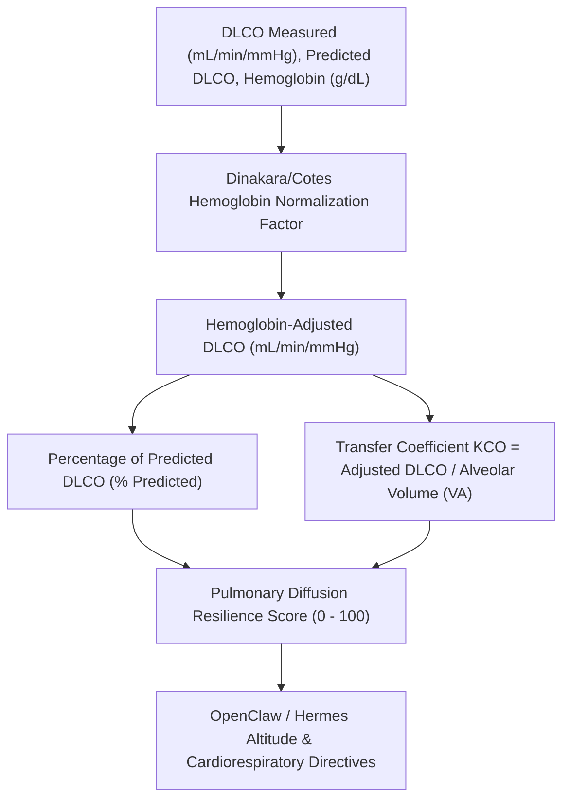

# Alveolar-Capillary Gas Diffusion (DLCO) Skill

A sovereign personal agent capability for computational pulmonary physiology, evaluating single-breath diffusing capacity of the lung for carbon monoxide (DLCO), hemoglobin normalization, and transfer coefficient (KCO).

## Architecture



## Quickstart

```python
from client import AlveolarCapillaryDiffusionClient

client = AlveolarCapillaryDiffusionClient()

# Assess DLCO pulmonary gas exchange
res = client.evaluate_dlco_diffusion(
    measured_dlco_ml_min_mmhg=28.2,
    predicted_dlco_ml_min_mmhg=30.0,…
