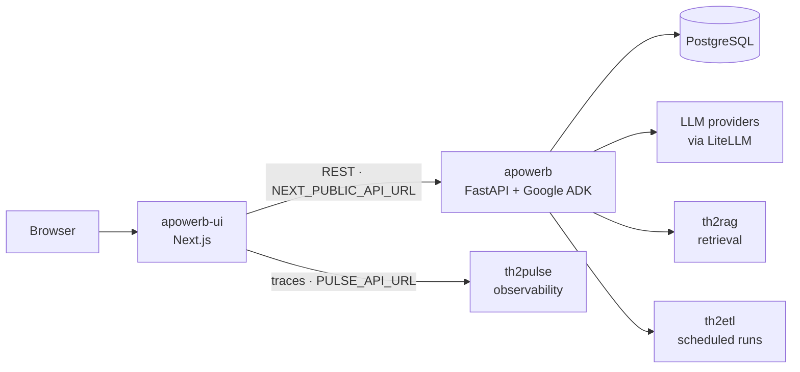

# apowerb-ui

**The official web interface for apowerb — build an agent, give it tools and knowledge, run it, and watch what it did.**

---

The web interface for [**apowerb**](https://github.com/apowerb/apowerb) — build an agent,
give it tools and knowledge, run it, and watch what it did.

apowerb is an agentic framework: a REST API that stores agents, builds them on Google ADK
and runs them. This repository is the front end that makes it usable by someone who is not
going to write `curl` calls — the Studio. It talks to an apowerb instance over HTTP and
holds no business logic of its own.

Built with Next.js 16 (App Router), React 19 and Tailwind. Documentation:
[docs.apowerb.com](https://docs.apowerb.com).

## How it fits together

The interface never reaches the database or an LLM directly.…
