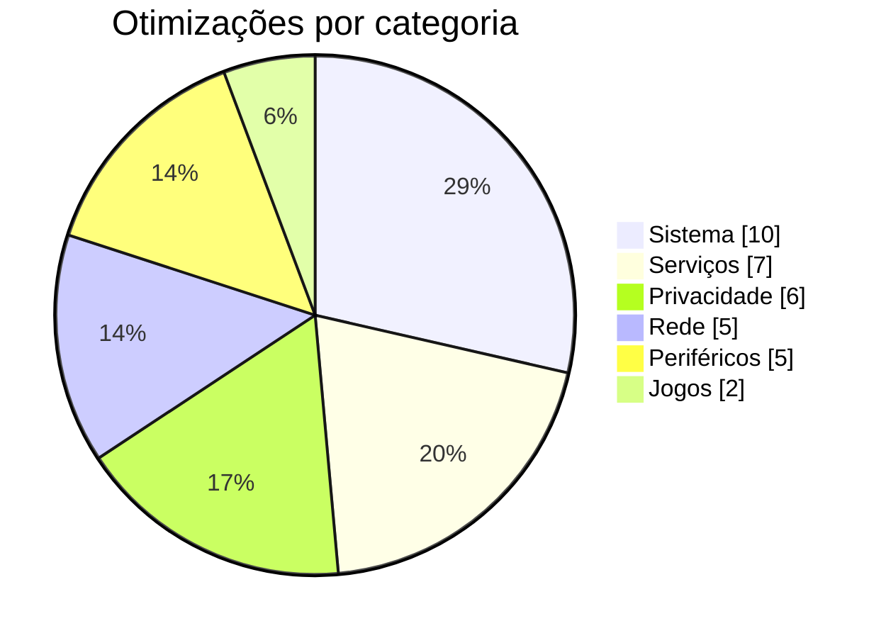

# ⚡ Tutu's Optimizer

  Compatível com Windows 10 e 11.

> O card acima é gerado por uma API pública. Os gráficos abaixo usam Mermaid, renderizado pelo GitHub; não há arquivos de imagem no repositório.

## Sobre

O **Tutu's Optimizer** é um aplicativo local para centralizar ajustes, manutenção e monitoramento do Windows em uma interface gráfica. Permite escolher otimizações por categoria, acompanhar a execução por logs e reverter os ajustes compatíveis.

### O que oferece

- 35 ajustes para sistema, privacidade, rede, jogos, periféricos e serviços;
- otimização rápida e seleção individual de ajustes;
- ferramentas de manutenção, incluindo limpeza de temporários e reparo do Windows;
- monitoramento de CPU, GPU, memória e armazenamento, conforme os dados expostos pelo hardware;
- catálogo de 49 jogos e suporte a executáveis personalizados;
- criação de ponto de restauração, logs e reversão de 34 ajustes;
- interface em modo claro ou escuro.

### Distribuição dos ajustes

## Requisitos

- Windows 10 ou…
