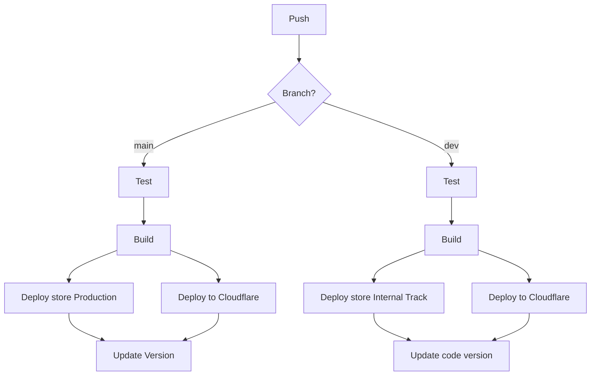

Breviarium App 🙏🏼

  Displays liturgical content and calendars of the Roman Rite of the Roman Catholic Church.<br>
  Supports Node v18+, Modern Browsers (desktop and mobile).

## Quickstart

This app uses [Breviarium](https://www.npmjs.com/package/breviarium) library (open source) with Liturgy of the hours.

To run the app:

```shell
# linux and mac users:
make install
# for windows users:
pnpm i
```

and run the ionic web app

```shell
# linux and mac users:
make run
# for windows users:
pnpm run dev
```

## CI/CD flow

GitHub Actions flow.


