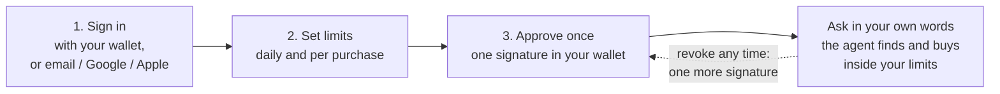

# SingIt

**Your agent spends. Your wallet keeps the money.**

SingIt is an AI agent that buys things for you — gift cards, eSIMs, mobile
top-ups, live data, paid AI answers — and pays for them in USDC over
[x402](https://www.x402.org/). You give it a budget instead of your wallet: two
limits and one approval. Your USDC stays in your own wallet on Base or Solana,
and the agent takes only what each purchase needs, inside those limits.

[Website](https://singitai.app) · [Open the app](https://app.singitai.app/app/) · [Documentation](https://github.com/bubon-ik/SingItAI/blob/HEAD/docs/README.md)

## How it works

Three steps, about a minute, then the agent just buys.

1. **Sign in.** Connect the wallet you already use — Rabby, MetaMask, Phantom,
   Solflare, or any mobile wallet through WalletConnect — or sign in with email,…
