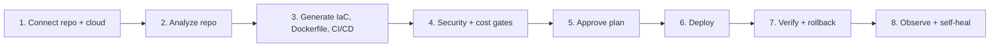

# 🪐 Orbitron — Autonomous Multi-Cloud DevOps Platform

> **Point it at a repo, pick a cloud, and let the agents do the rest.**

Orbitron is a multi-agent DevOps platform. It analyzes a Git repository, generates infrastructure-as-code, CI/CD, and container configuration for your target cloud (**AWS, GCP, Azure, or any Kubernetes cluster**), enforces security and cost gates, deploys, and then watches production with a self-healing SRE loop.

> [!IMPORTANT]
> **Project status: early alpha.** The end-to-end UI flow works, but several stages are still **simulated**. Read the [status table](#-what-works-today) before relying on it, and see the [Master Plan](https://github.com/bugrasurucu/autonomous-devops-platform/blob/HEAD/ORBITRON_MASTER_PLAN.md) for the roadmap.

---

## ✨ How it works

Five specialized agents run the pipeline in sequence:

| Agent | Responsibility |…
