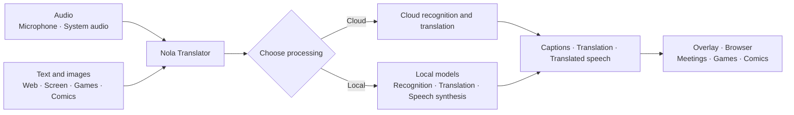

Nola Translator is a cross-platform real-time translation application for Windows and browsers. It supports local inference and cloud providers including Qwen, MiniMax, OpenAI-compatible APIs, Google Translate, Microsoft Translator and Index Translate. Features include live captions, meeting interpretation and comic translation.

## Demo

> **Tip**
>
> Click to experience the online demo

## How It Works

