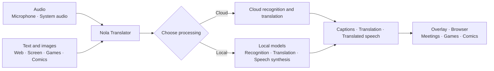

Nola Translator is a cross-platform real-time translation application for Windows and browsers. It supports local inference and cloud providers including Qwen, MiniMax, OpenAI-compatible APIs, Google Translate, Microsoft Translator and Index Translate. Features include live captions, meeting interpretation and comic translation.

## Demo

> [!TIP]
> Click to experience the online demo

## How It Works

| | |
|---|---|
| **Providers** | Alibaba Cloud, MiniMax, OpenAI, Gemini, Anthropic, DeepSeek, Google Translate, Microsoft Translator, OpenAI compatible interface, Anthropic, Ollama, etc.|
| **Local Models** | 26 ASR models, 17 translation models, 16 TTS models, 3 LLM models, 17 OCR models, 5 comic detection and…
