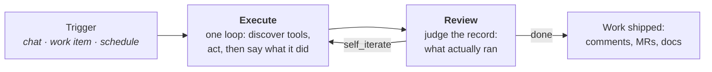

# Crewlet

**Run an AI agent company.**

Crewlet is an open-source Go engine for orchestrating hierarchically organized
AI agent companies. You describe a company in YAML — mission, org chart, roles,
policies, integrations — and Crewlet runs it: one persistent agent per seat,
planning and executing real work in chat, your issue tracker, and your code host,
learning from what it did, and escalating to the humans in the org chart when stuck.

---

## The org chart is the execution graph

Identity, delegation, communication and knowledge are scoped by a seat's place in the hierarchy. The chart you draw is the graph the engine runs.

---

## How a turn works

A trigger (a chat message, a work-item webhook, a schedule) wakes exactly one agent, which runs a two-stage turn:

