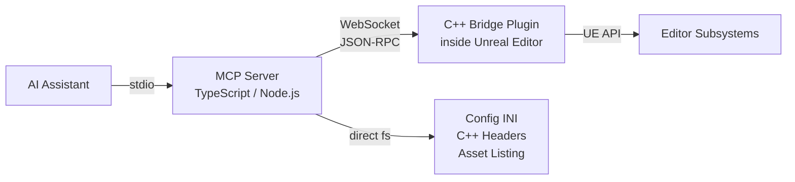

# UE-MCP

**Unreal Engine Model Context Protocol Server** - gives AI assistants deep read/write access to the Unreal Editor through 30 category tools covering 2100+ actions, plus a YAML flow engine for multi-step workflows and an npm plugin system for extending the surface.

That total is 1270+ actions of ue-mcp's own plus Epic's entire native AI Toolset Registry: on UE 5.8+ its 830 official Unreal tools are called in-process and surfaced as `epic_*` actions in the matching category, Sequencer in `animation`, PCG in `pcg`, static meshes in `asset`.

Blueprints, materials, levels, actors, animation, VFX, landscape, PCG, foliage, audio, UI, physics, navigation, AI, StateTree, GAS, networking, sequencer, build pipeline - all programmable through natural language.

Filesystem reads (INI config, C++ headers, asset listing) work with the editor closed, so an agent can explore the…
