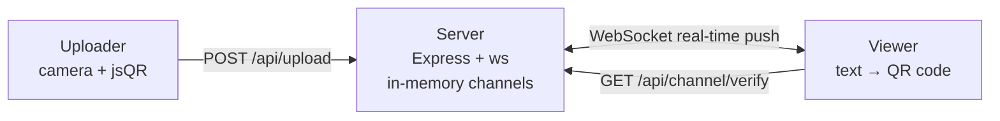

Scan to upload, redraw in real time — a real-time QR code delivery system based on WebSocket

  &nbsp;·&nbsp;
  &nbsp;·&nbsp;
  &nbsp;·&nbsp;
  &nbsp;·&nbsp;
  &nbsp;·&nbsp;
  &nbsp;·&nbsp;
  &nbsp;·&nbsp;
  &nbsp;·&nbsp;

---

## What this is

The uploader scans with the camera (jsQR) to decode a QR code into text. The viewer uses an 8-digit share code to open a WebSocket, receives the text in real time, and regenerates the QR code. Neither side requires login, and they do not communicate directly.

- **Scan to upload**: the uploader only does scan → decode → POST, and does not keep any history locally.
- **Real-time redraw**: the server pushes the latest text over WebSocket, and the viewer redraws the QR code each time it receives a message.
- **No database**: channels are kept in process memory and expire after 30 minutes without an upload by default.

> Official instance: <https://qr-live.cxs.apps.dynesshely.top>

## Architecture

In…
