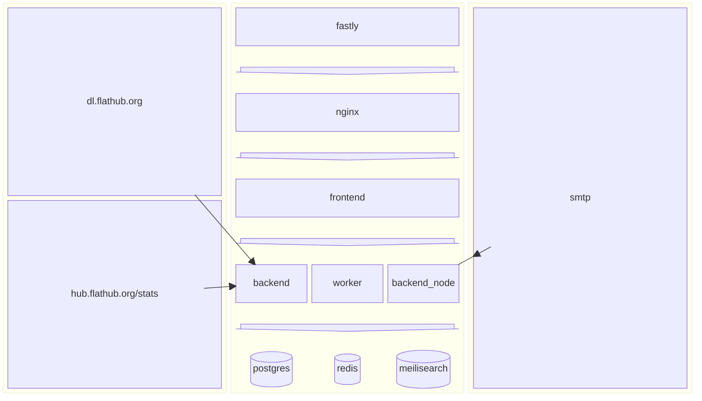

# flathub.org

This is the source code for the website, both backend and frontend. That's running on https://flathub.org.

## Code contribution

First of all thanks for considering contributing to this project!

Pull requests are welcome. Please, create an issue first explaining what you want to do and how.

If you want to contribute translations, please check out the instructions below.

### Overview

This overview is supposed to give you a quick grasp, of what we have and how it works. There are subtle differences between local/prod - this is an approximation.

###…
