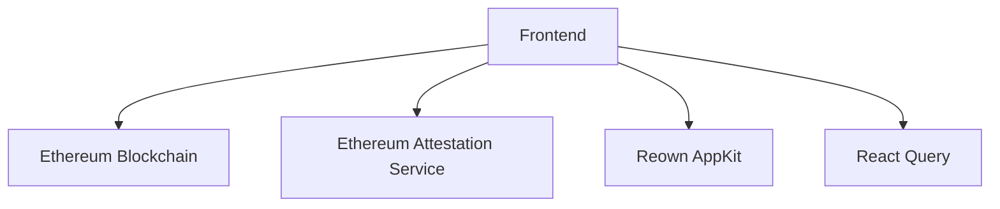

# DeVouch Frontend

## 1. Project Overview

### Purpose

DeVouch is a decentralized verification and attestation platform built on the Ethereum blockchain. The frontend application provides a user-friendly interface for creating, managing, and verifying attestations using the Ethereum Attestation Service (EAS).

### Key Features

-   Web3 wallet integration for secure authentication
-   Attestation creation and management
-   Real-time verification of attestations
-   Responsive and modern UI built with Next.js and Tailwind CSS

### Live Links

-   Production: [https://devouch.xyz/](https://devouch.xyz/)
-   Staging: [https://staging.devouch.xyz/](https://staging.devouch.xyz/)

## 2. Architecture Overview

### System Diagram

### Tech Stack

-   **Framework**: Next.js 16
-   **UI**: React 19, Tailwind CSS 4
-   **State Management**: React Query
-   **Web3 Integration**:
    -   Wagmi
    -   Viem
    -   Reown AppKit (formerly Web3Modal)
-   **Attestation Service**: EAS SDK
-   **Language**: TypeScript
