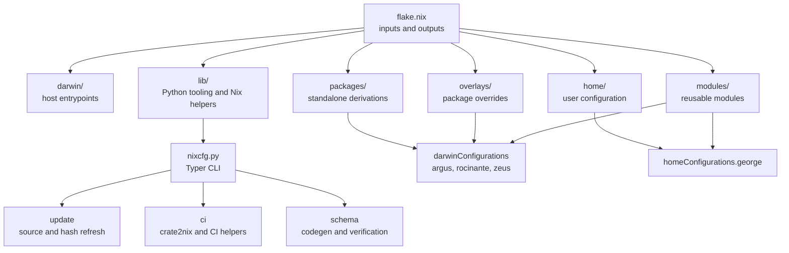

# nixcfg

Unified [Nix flake](https://nix.dev/concepts/flakes) for macOS hosts,
[Home Manager](https://github.com/nix-community/home-manager) user
configuration, and reusable module building blocks.

The repository still targets George's machines, user profile, and workflows.
Ongoing work separates those personal defaults into reusable framework
primitives and a standalone module library.

## Repository map

Read…
