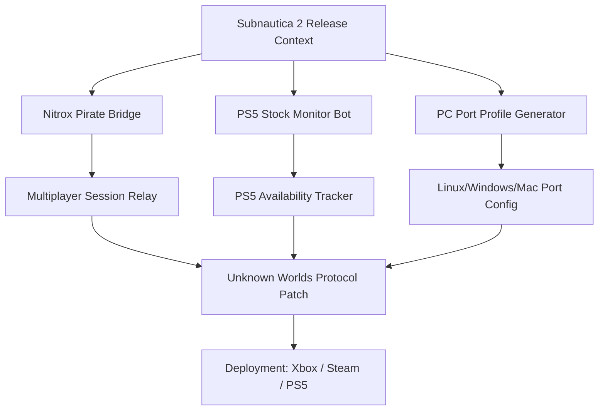

# 🌊 Subnautica 2: Leviathan Bridge – Cross-Platform Porting Toolkit

> *"When the abyss calls, answer with technology."*  
> A curated infrastructure for bridging **Subnautica 2** across multiple platforms, enabling early-access multiplayer experimentation, PS5 stock monitoring, and community-driven porting utilities. This repository is not a game modification—it is a **shipbuilder’s workshop** for navigating the deep waters of cross-platform deployment.

---

## 🔱 Repository Compass

---

## 🧭 Why This Exists

The **Subnautica 2** early-access landscape is a fragmented ocean. Some players traverse the depths on PlayStation 5, others on PC via Steam or Xbox, while the **Nitrox multiplayer community** sails independently. This repository builds a **digital causeway** between these…
