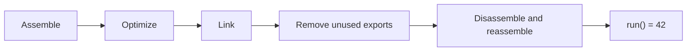

# Silmaril

Silmaril uses Lean 4 to model programs and prove properties about them. It includes
a WebAssembly toolkit with Binaryen-style commands and a library of logics,
models, lambda calculi and verified translations.

## Try the Binaryen demo

Install [elan](https://github.com/leanprover/elan), Git, GNU Make, a native C
toolchain, Python 3.11+ and Node.js 24+, or use the
[development environments](https://github.com/hiloopai/silmaril-lean/blob/HEAD/docs/development.md).

```sh
git clone https://github.com/hiloopai/silmaril-lean.git
cd silmaril-lean
make cache
make demo
```

The demo exercises all seven tools: it assembles two modules, removes dead code,
links them, keeps the selected exports, converts the result to text and back,
and checks that `run()` returns **42** in both the Lean WebAssembly interpreter
and Node.
A second example precomputes a constructor and checks that its getter returns
**9**.



The binaries are in `build/bin/`. Use their standalone names or the `sil`
dispatcher:

```sh
export…
