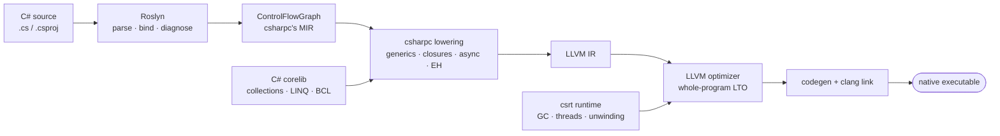

# csharpc

**A C# front-end for LLVM.**
csharpc compiles C# source code straight to LLVM IR and then to small, fast native executables —
what `clang` is to C, `rustc` to Rust and `gollvm` to Go.

csharpc is written in C# (.NET 11). It uses **Roslyn** as its parser and type checker — so every
diagnostic, overload resolution and language rule is exactly the official compiler's — and the
**LLVM C API** as its backend. Everything in between is csharpc: lowering Roslyn's control-flow graph
to LLVM IR, the object model, a garbage-collected runtime, a C# corelib, and the driver. No IL, no JIT
and no CoreCLR at run time: the output is an ordinary native executable.
