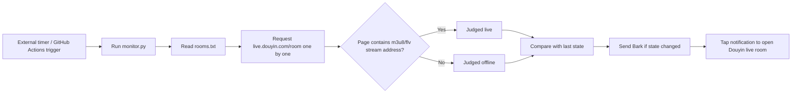

# Douyin Live Room Start/Stop Monitor

Automatically monitors a batch of Douyin live rooms. Whenever a room goes live or ends its stream, it sends a push notification to iPhone via Bark. Tapping the notification opens the corresponding live room directly in Douyin through its URL Scheme (`snssdk1128://live`).

## How It Works

Detection basis: the `liveStatus` field in Douyin's web SSR data also returns `normal` for rooms that are live, so it is unreliable. However, offline room pages contain zero real stream addresses such as `m3u8/flv/pull_url`, while live rooms contain many. Therefore, “the page contains real stream addresses” is used as the reliable signal for live status. If the page cannot be fetched or an error occurs, no notification is sent in…
