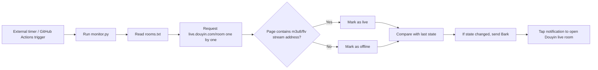

# Douyin Live Room Start/Stop Monitor

Automatically monitors a list of Douyin live rooms. As soon as a room goes live or ends its broadcast, a notification is pushed to iPhone via Bark. Tapping the notification opens the Douyin app directly to the corresponding live room using the Douyin URL Scheme (`snssdk1128://live`).

## How It Works

Detection basis: the `liveStatus` field in Douyin's web SSR also returns `normal` for rooms that are currently live (unreliable). However, on offline room pages, the count of real stream addresses such as `m3u8/flv/pull_url` is 0, while live rooms have many. Therefore, "the page contains real stream addresses" is used as the reliable signal for being live. If the page cannot be fetched or an error occurs, no…
