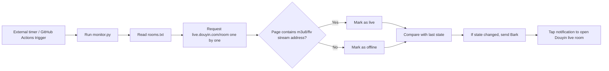

# Douyin Live Room Start/End Monitor

Automatically monitors a batch of Douyin live rooms. Once a room goes live or goes offline, it pushes a notification to iPhone via Bark. Tapping the notification opens Douyin directly through its URL Scheme (`snssdk1128://live`) and enters the corresponding live room.

## How It Works

Detection basis: the `liveStatus` field in Douyin's web SSR also returns `normal` for rooms that are live, so it is unreliable. For offline rooms, however, the count of real stream addresses such as `m3u8/flv/pull_url` on the page is 0, while live rooms contain many. Therefore, "the page contains real stream addresses" is used as the reliable signal for being live. If the page cannot be fetched or is abnormal, no notification is sent…
