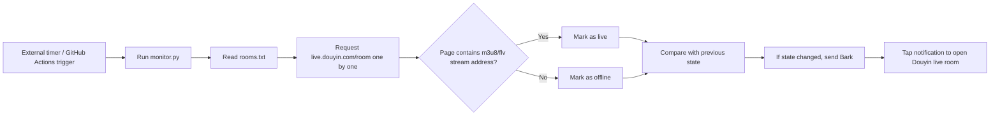

# Douyin Live Room Start/Stop Monitor

Automatically monitors a batch of Douyin live rooms. Once a room goes live or ends its broadcast, it pushes a notification to iPhone via Bark. Tapping the notification opens the corresponding live room directly in Douyin using its URL Scheme (`snssdk1128://live`).

## How It Works

Detection basis: Douyin's web SSR `liveStatus` field also returns `normal` for rooms that are currently live, so it is not reliable. However, offline room pages contain zero real stream addresses such as `m3u8/flv/pull_url`, while live rooms contain many. Therefore, 'page contains real stream addresses' is used as the reliable signal for a live room. If the page cannot be fetched or an error occurs, no notification is sent in that…
