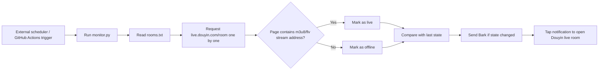

# Douyin Live Room Go-Live/Offline Monitor

Automatically monitors a list of Douyin live rooms. As soon as a room goes live or goes offline, a notification is pushed to iPhone via Bark. Tapping the notification uses the Douyin URL Scheme (`snssdk1128://live`) to open Douyin directly into the corresponding live room.

## How It Works

Detection basis: the `liveStatus` field in Douyin's web SSR data also returns `normal` for rooms that are live (unreliable). However, offline room pages contain zero real stream addresses such as `m3u8/flv/pull_url`, while live rooms contain many. Therefore, "the page contains real stream addresses" is used as the reliable signal for a room being live. If the page cannot be fetched or an error occurs, no notification is…
