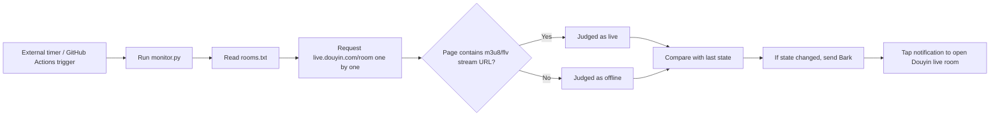

# Douyin Live Room Start/Stop Monitor

Automatically monitors a batch of Douyin live rooms. Once a room goes live or ends, it sends a push notification to iPhone via Bark. Tapping the notification can open Douyin directly to the corresponding live room using the URL Scheme (`snssdk1128://live`).

## How It Works

Basis for judgment: The `liveStatus` field in Douyin's web SSR also returns `normal` for rooms that are currently live (unreliable). However, on offline room pages, the count of real stream URLs such as `m3u8/flv/pull_url` is 0, while live rooms contain many. Therefore, "the page contains real stream URLs" is used as the reliable signal for being live. If the page cannot be fetched or an error occurs, no notification is sent in that run (to…
