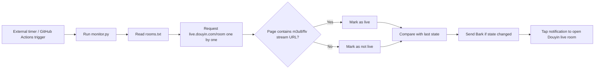

# Douyin Live Room Start/Stop Monitor

Automatically monitors a batch of Douyin live rooms. Once a room starts or ends a broadcast, a notification is pushed to iPhone via Bark. Tapping the notification opens Douyin directly through the URL Scheme (`snssdk1128://live`) and enters the corresponding live room.

## How It Works

Detection basis: the `liveStatus` field in Douyin's web SSR also returns `normal` for rooms that are live (unreliable). However, on offline room pages, the count of real stream addresses such as `m3u8/flv/pull_url` is 0, while live rooms have many. Therefore, "the page contains real stream addresses" is used as the reliable signal for being live. If the page cannot be fetched or an error occurs, no notification is sent for that check…
