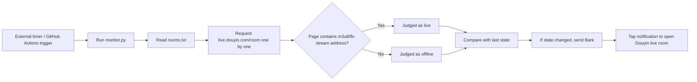

# Douyin Live Room Start/Stop Monitor

Automatically monitors a batch of Douyin live rooms. Once a room goes live or ends, it pushes a notification to iPhone via Bark. Tapping the notification uses the Douyin URL Scheme (`snssdk1128://live`) to open Douyin directly into the corresponding live room.

## How It Works

Detection basis: the `liveStatus` field in Douyin's web SSR also returns `normal` for rooms that are live (unreliable), but offline room pages have zero real stream addresses such as `m3u8/flv/pull_url`, while live rooms have many. Therefore, "the page contains real stream addresses" is used as the reliable signal for being live. If the page cannot be fetched or an error occurs, no notification is sent this time (to prevent false…
