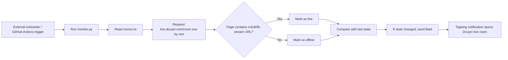

# Douyin Live Room Start/Stop Monitor

Automatically monitors a list of Douyin live rooms and pushes a notification to iPhone via Bark whenever a room goes live or goes offline. Tapping the notification uses the Douyin URL Scheme (`snssdk1128://live`) to open Douyin directly into the corresponding live room.

## How It Works

Detection basis: the `liveStatus` field in Douyin's web SSR also returns `normal` for rooms that are live (not reliable), but on offline room pages the count of real stream addresses such as `m3u8/flv/pull_url` is 0, while live rooms contain many of them. Therefore, "the page contains real stream addresses" is used as the reliable signal for being live. If the page cannot be fetched or an error occurs, no notification is sent for…
