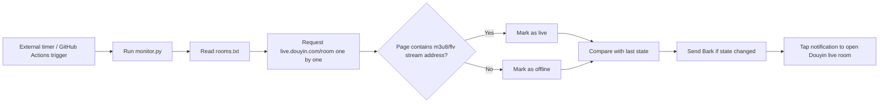

# Douyin Live Room Start/Stop Monitor

Automatically monitors a batch of Douyin live rooms. Once a room goes live or ends, it pushes a notification to iPhone via Bark. Tapping the notification uses the Douyin URL Scheme (`snssdk1128://live`) to open Douyin directly into the corresponding live room.

## How It Works

