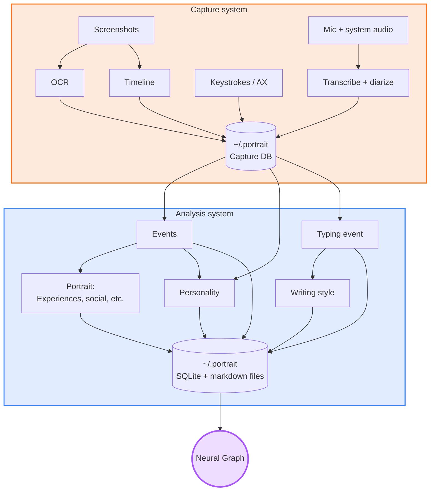

---

## How it works

## The Neural Graph

Over time, My Portrait builds a memory graph and a portrait graph that belong only to you, out of what it sees and the algorithms built into it.

## Install

1. Download the `.dmg` from [the latest release](https://github.com/joyzhang14-14/My-Portrait/releases/latest).
2. The app is self-signed, so Gatekeeper…
