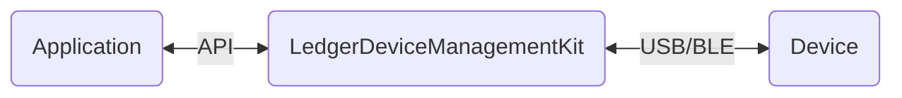

·
    ·
  

# Introduction

The Device Management Kit (DMK) is a TypeScript library that provides easy communication with Ledger devices:

- Device discovery, identification, and connection
- Device management operations (app installation, device info retrieval) with comprehensive status tracking and error handling
- Ledger OS interaction
- App interaction for cryptographic operations
  - Address derivation, message and transaction signing
- App installation and management
- 🔜 OS updates

## How it works

The Device Management Kit features an interface for applications to handle any Ledger device (a.k. hardware wallets). It converts intention into

The Device Management Kit is available in 3 different environments (web, Android & iOS).

This repository contains the **web implementation** of the Device Management Kit, built with TypeScript.

## Structure

### Repository

The Device Management Kit is structured as a monorepository that centralizes all TypeScript code related to the Device Management Kit in one place.

This project uses [turbo…
