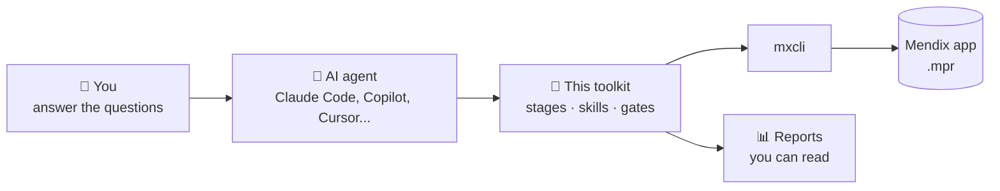

# mxcli-project-toolkit

> **Agents: this README is orientation, not the spec.** For any pipeline work, the executable authority is `skills/conversion-runbook.md` (stages, gates, interview protocol) plus each stage's owning skill — load those before producing anything. Stage summaries here and in `toolkit-guide.html` are routing, not deliverable lists.

**A harness for AI coding agents that build and change Mendix apps, so the result is one you can review and trust.**
Every decision written down, every stage gated, every rule learned on a real project.

## What it is

A process layer on top of [mxcli](https://github.com/mendixlabs/mxcli). Clone it once; each
project points at it.

**Measured in 1.0** ([release notes](https://github.com/MendixMau/mxcli-project-toolkit/blob/HEAD/docs/releases/v1.0.md)):

| **5 of 5** vs 0 of 5 | **~40%** | **0 to 1** of 20 |
|:---:|:---:|:---:|
| drafts that…
