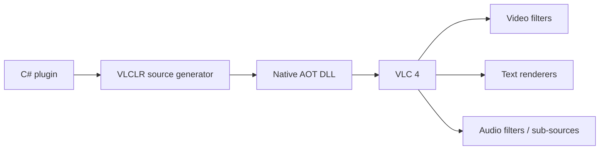

# VLCLR

> Experimental project. Do not use it in production.

**VLC + CLR = VLCLR** is a framework for authoring VLC 4.x plugins in C# and
publishing them as Native AOT libraries that VLC loads directly—without a
separate C shim.

Current target: Windows x64, .NET 10, VLC 4.0.6.

## What is included

- Attribute-based modules with generated exports, callbacks, configuration,
  exception boundaries, and instance lifecycle.
- Base classes and ABI wrappers for video, subtitle, audio, player, and
  playlist integration.
- Low-level fluent module registration for advanced or multi-module plugins.
- Unit, ABI, Native AOT export, VLC integration, visual, and benchmark coverage.

## Samples

Each sample owns its setup, commands, parameters, examples, architecture, and
troubleshooting documentation.

| Sample | Capability | Guide |
|---|---|---|
| YOLOX object detection | D3D11/OpenVINO GPU video filter with COCO-80 boxes and labels…
