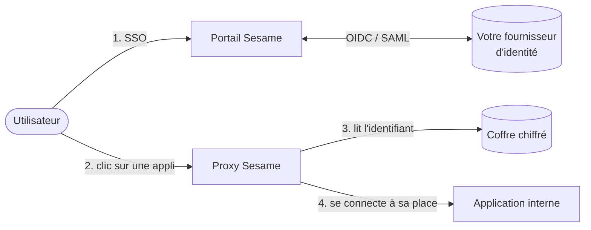

Vos utilisateurs se connectent **une seule fois** avec le compte de votre organisation
(Entra ID, Keycloak, Okta… en OIDC ou SAML). Sesame se connecte ensuite **à leur place**
aux applications internes qui n'ont qu'un formulaire de login, avec des identifiants
qu'ils ne voient jamais. **Aucun mot de passe applicatif n'atteint le navigateur**, et
chaque accès est tracé.

Aucune modification des applications, aucune extension de navigateur.

## Comment ça marche

1. L'utilisateur ouvre le portail et se connecte avec son compte habituel : il voit la liste de ses applications.
2. Chaque application est servie par Sesame à sa propre adresse (`compta.sesame.example.com`).
3. Au premier accès, le proxy lit l'identifiant de cet utilisateur pour cette appli dans le coffre chiffré…
4. …rejoue le formulaire de connexion côté serveur, garde la session et relaie les pages. Si la session expire,…
