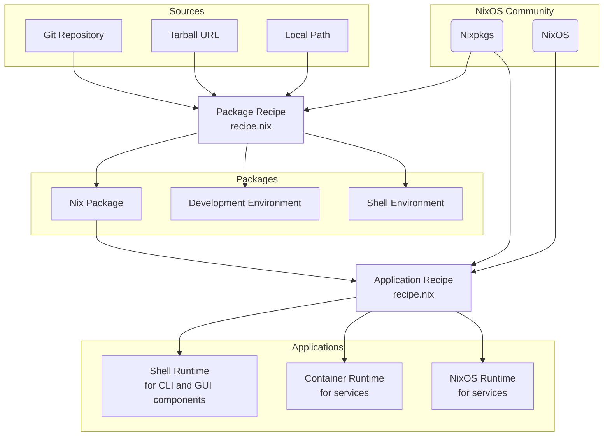

# NGI Forge

This software is in active development. Expect backwards incompatible changes.

## Features

- Simple, type checked configuration recipes for **packages** and
  **multi-component applications** using
  [module system](https://nix.dev/tutorials/module-system/index.html)

- [Web UI](https://ngi.nixos.org)

- Easy [self hosting](#self-hosting)

### Conceptual diagram

##…
