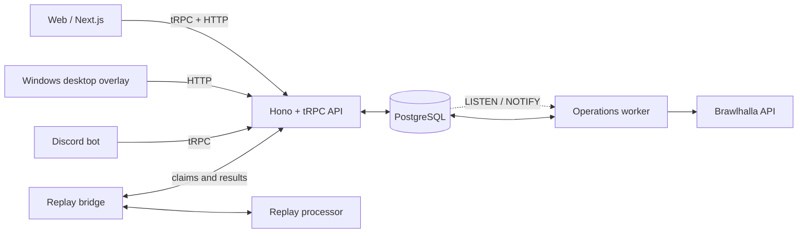

Brawlhalla player tracking for stats, rankings, clans, rating history, and live opponent insights.

## Features

- **Player profiles:** ranked stats, legends, weapons, and rating history
- **Leaderboards:** 1v1, 2v2, Solo 2v2, and 3v3 with region filters and pagination
- **Queue:** recent ranked activity inferred from leaderboard scan deltas
- **Clans and discovery:** clan pages and searchable player aliases and former names
- **Discord bot:** slash commands for player, clan, and service information
- **Desktop overlay:** live Windows opponent detection and player insights
- **Durable refresh operations:** PostgreSQL-backed refresh, ranking, discovery, and projection work
- **Replay analysis preview:** backend replay processing coordinated through the replay bridge

## Architecture

-…
