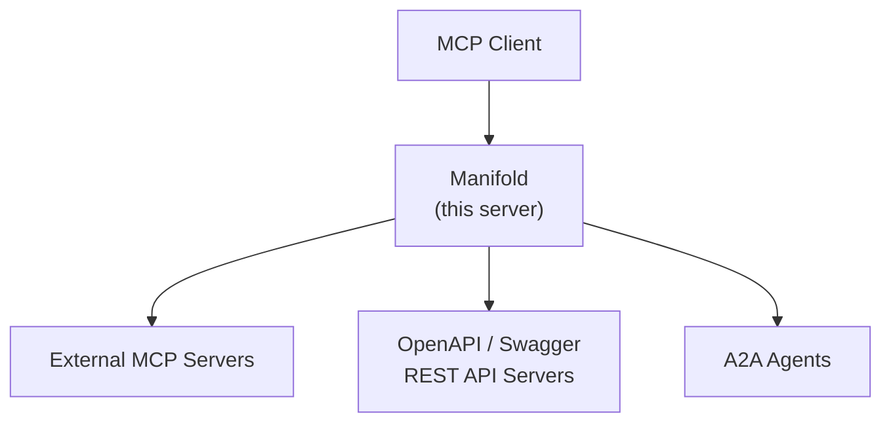

# Manifold

**One interface. Many connections. Manifold.**

English | [日本語](https://github.com/nonchan7720/manifold/blob/HEAD/README_ja.md)

Manifold is a gateway that acts as an MCP server while connecting to multiple external MCP servers and OpenAPI / Swagger-compliant REST APIs on the backend.

## Why "Manifold"?

The name **Manifold** comes from an engine's **intake manifold**.

An intake manifold is the component that distributes air and fuel evenly and efficiently from a single inlet to multiple cylinders. We named this project **Manifold** because its structure is similar.

| Engine manifold        | This project                         |
| ---------------------- | ------------------------------------ |
| Single inlet           | Requests from MCP clients            |
| Distribution / routing | Protocol conversion / routing        |
| To multiple cylinders  | To multiple external MCP / REST APIs |

## Architecture

