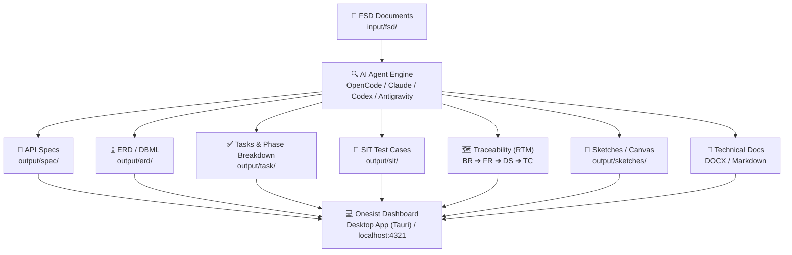

# Onesist (SA Dashboard)

**A full-stack desktop & web workspace for System Analysts.** View, edit, and orchestrate AI-generated system specifications, FSD documents, API specs, ERD schemas, test cases, task breakdowns, traceability matrices, and visual canvas sketches — all integrated seamlessly with CLI AI agents.

## Features

| Feature / Page | What it does |
|----------------|-------------|
| **Projects Dashboard** | Manage and organize project repositories with automatic skill installation (`fsd-analyzer`, `markitdown`). |
| **Project Overview** | Project hub with multi-root…
