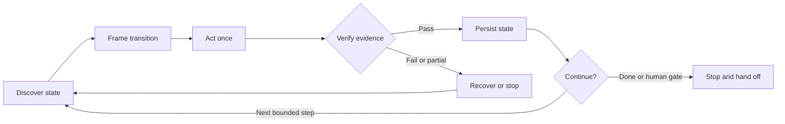

# GitHub Loop Engineering Skill

> The GitHub-native control plane for Loop Engineering.

An Agent Skill that turns GitHub Issues and GitHub Projects into durable state, evidence, and handoff for repeatable agent work—all through the official [GitHub MCP Server](https://github.com/github/github-mcp-server).

Loop Engineering is about designing the repeatable system around an agent: what it discovers, which bounded transition it attempts, how the result is verified, what gets persisted, and when the loop continues or stops. This skill applies that discipline to the work lifecycle.

## The project board as loop memory

GitHub is more than the task list in this loop:

| Loop stage | What the skill does | Durable artifact |
|:--|:--|:--|
| Discover | Read live repository, issue, hierarchy, Project fields, and policy | Current world state |
| Frame |…
