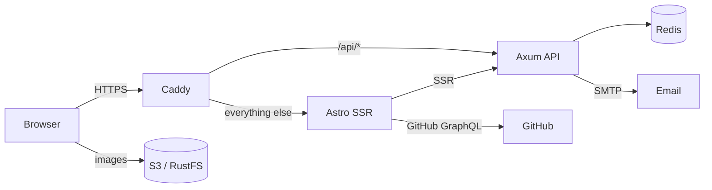

The source of my personal site. Astro and Svelte on the front,
    Rust and Axum behind it, Caddy at the edge.

This is the code behind [everdev.it](https://www.everdev.it). It is a bilingual portfolio, a writing archive, a reading list, and a small systems project.

[Stack](#stack) · [Architecture](#architecture) · [The flow](#the-flow) · [Repository map](#repository-map)

## Stack

| Layer | What |
| --- | --- |
| Frontend | Astro 7 SSR, Svelte 5, TailwindCSS 4, shadcn-svelte, Paraglide (EN/ZH) |
| API | Rust, Axum, Redis, feedback email |
| Media | RustFS S3 |
| Edge | Caddy, automatic TLS |

## Architecture

The browser talks to the API through Caddy on the same origin. The Astro server renders pages and calls the API directly over the private network. Content images go straight from S3 to the browser, never through the app. Social previews are generated by the Astro server with Satori.

## The…
