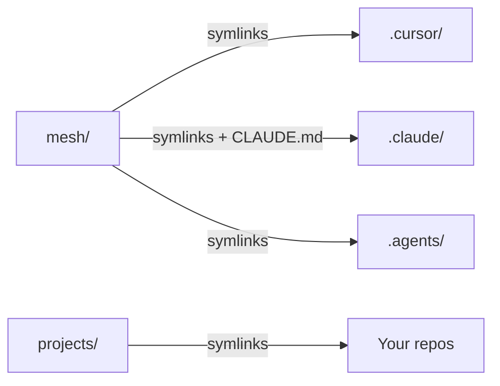

# mAIcelium

A centralized, multi-IDE workspace that connects AI coding agents to shared knowledge — like a fungal network feeding nutrients to every organism in the forest.

## The problem

When you work with multiple AI-powered IDEs (Cursor, Claude Code, Antigravity), each one maintains its own rules, skills, and context in isolation. You end up duplicating configurations, losing consistency, and manually keeping things in sync.

## The solution

mAIcelium provides a single workspace directory where:

- **One source of truth** (`mesh/`) orchestrates all rules, skills, prompts, and commands, including optional layer repos mounted under `mesh/layers/`.
- **Symlinks** distribute that knowledge to each IDE in the format it expects.
- **Projects plug in and out** without copying files — just symlinks to your real repos.
- **Scripts automate everything** — no manual symlink management.

