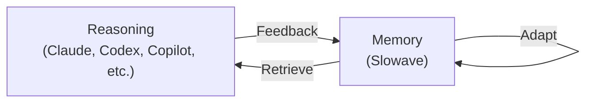

---

Slowave is a local MCP memory server that carries your decisions, constraints, and procedures across your coding sessions and AI tools.

Slowave adapts as you use it, building reusable context over time so your agent can learn from past experience.

It runs on your machine and requires no LLM API key for memory maintenance. 

The local dashboard lets you inspect your memories and how they support your agent in your day to day work.

---

https://github.com/user-attachments/assets/2d4eeb4e-419f-46fa-b23e-cf501a715d1e

---

At the core Slowave is built around a simple concept:

> **Reasoning and memory feed each other in a continuous loop.**

Slowave retains what helps agents achieve their goals, weakens what does not, and continuously adapts based on use. It does this through a continuous feedback loop between your agent and its memory. It works on 5 simple MCP endpoints:

> **activate → remember → recall → feedback → commit**

Memory is continuously reshaped by use rather than a static…
