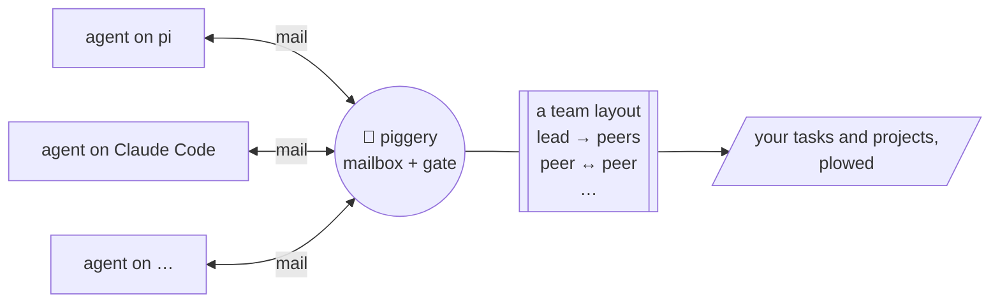

https://github.com/user-attachments/assets/0b4871d7-96ec-4262-a8cc-3373800ba68d

Work goes into a pig's trough and waits there until the pig is back. It only counts as eaten
when the job is actually done, not when the pig sniffed at it. Every pig also has a pen: its
role says who it may talk to and whether it may have piglets (workers). The farm checks the
fence itself, so no amount of sweet talk gets a pig through it.

pi, Claude Code, Codex, omp, dsh and opencode pigs all live on the same farm and talk to each other. The
farm is one Go binary and a SQLite file, and nothing runs in the cloud.

## How it works

- **One mailbox for every agent**, whatever its harness. A pi session can mail a Claude Code
  session, and a worker's answer wakes whoever is waiting for it.
- **A gate on every mail and every spawn.** It checks them against the team's layout, a small
  YAML file you…
