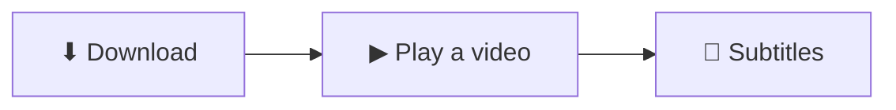

English | [繁體中文](https://github.com/sunososobro-hub/tinglongwu/blob/HEAD/README.zh-TW.md) | [简体中文](https://github.com/sunososobro-hub/tinglongwu/blob/HEAD/README.zh-CN.md)

# tinglongWu 聽龍

| 🎧 Listen | 🗣️ Speak | 🔁 Two-way |
|:-:|:-:|:-:|
| Subtitles | Voice out | Both sides |

Offline real-time speech translation. No cloud, no recordings kept by default.

## Download

| | Install |
|---|---|
| **Windows 10/11** | **[⬇ Download tinglongwu-setup.exe](https://github.com/sunososobro-hub/tinglongwu/releases/latest/download/tinglongwu-setup.exe)**, run it, keep clicking **Next** |
| macOS | `curl -fsSL https://github.com/sunososobro-hub/tinglongwu/releases/latest/download/mac_install.sh \| bash` |
| Linux (x86_64) | `curl -fsSL https://github.com/sunososobro-hub/tinglongwu/releases/latest/download/install.sh \| bash` |

Windows shows a SmartScreen warning because the installer is unsigned until #601 lands: Edge first says the file "isn't commonly downloaded" and hides Keep: hover the download → **…** → **Keep** → open the ▾ next to **Delete** → **Keep anyway**; then on the SmartScreen…
