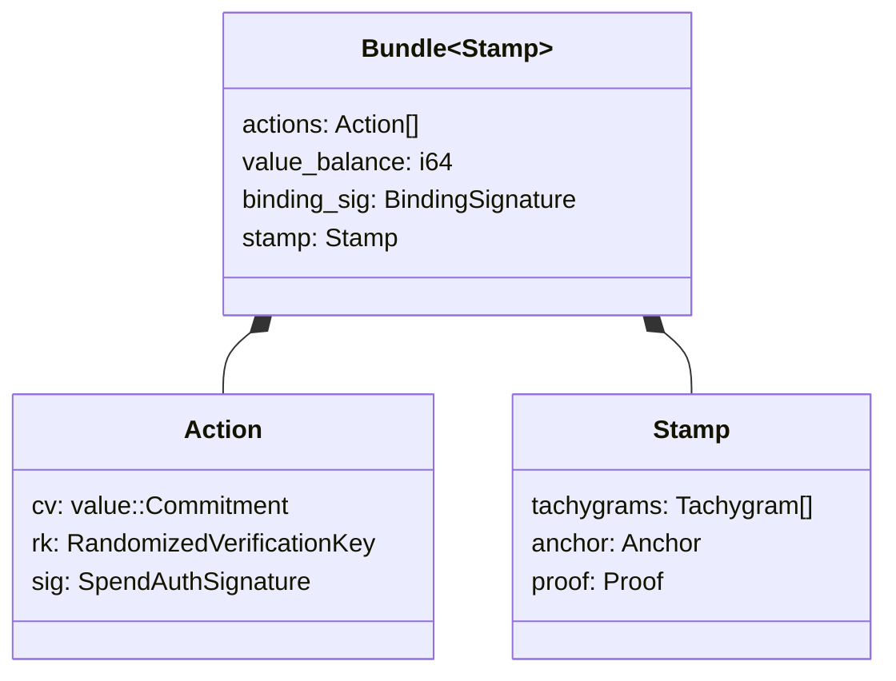

# Tachyon

The Tachyon shielded transaction protocol for Zcash.

## Architecture

### Transaction Structure

A **bundle** contains actions, a value balance, and a binding signature.
Each **action** carries a value commitment (`cv`), a randomized verification
key (`rk`), and a spend authorization signature (`sig`).

**Tachygrams** (nullifiers and note commitments) live in the **stamp**, not
in the action. This separation enables stamp stripping during proof
aggregation while actions retain their authorization.

## Status

Core cryptographic plumbing is implemented and tested:

- Key derivation (PRF^expand with sign normalization)
- Value commitments (Pedersen over Pallas, shared generators with Orchard)
- Spend authorization…
