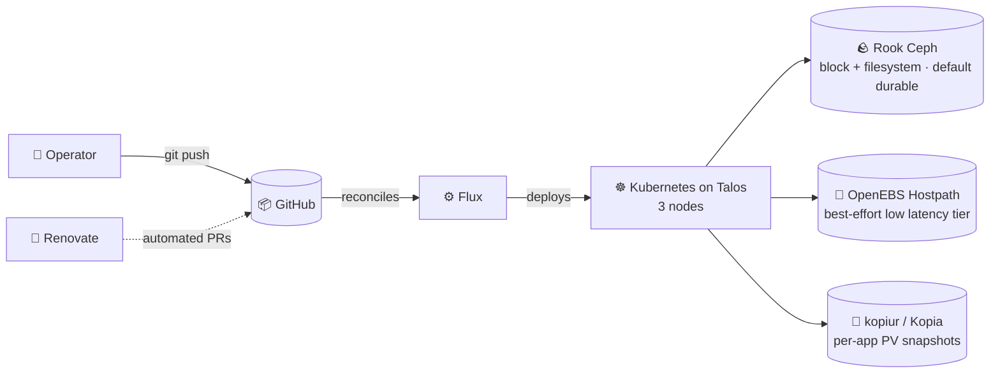

# Cluster

**GitOps** with Flux · **Self-hosted by design**

---

## 📖 Overview

This is my live configuration for a 3-node Talos Linux cluster. Every change lands in Git first;
Flux reconciles the cluster from there, and Renovate keeps images and charts current via PRs.

The repo is GitOps-strict: applications are declared as `HelmRelease`
resources, all secrets live in SOPS-encrypted manifests.

The cluster is operated by me; agents are tools in that loop. I make
use of agentic workflows: agent-authored PRs, automated review and
skill-driven operations, nothing goes live without me deciding it should.

---

## 🗺️ Architecture

Storage classes are picked per workload by durability requirement: Ceph for
anything that must…
