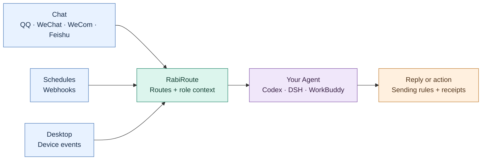

English | <a href="./README_zh.md">简体中文</a> | <a href="./README_ja.md">日本語</a>

# RabiRoute

RabiRoute is a **self-hosted message gateway and policy router for AI agents**. Connect chats, desktop events and smart devices to the Agent you already use, with role context, scheduled tasks and recorded results.

**RabiRoute connects and routes. Your Agent owns the model, tools and execution.**

[Overview](#what-it-connects) · [Get started](#get-started) · [Architecture](#architecture) · [Docs](#documentation) · [Community](#community)

## What it connects

QQ…
