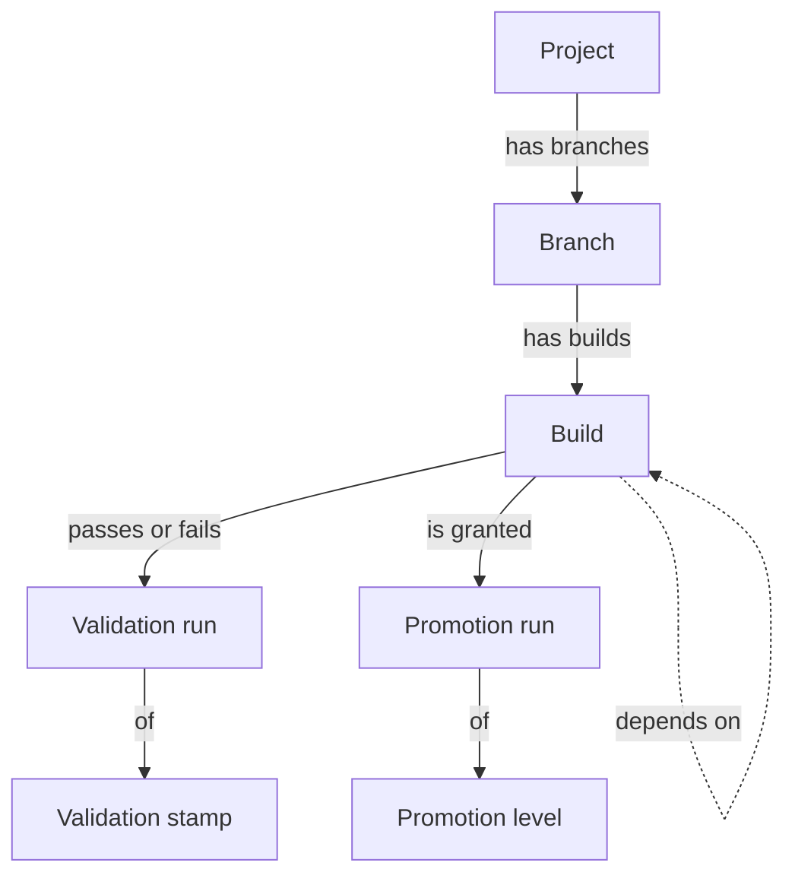

### Track. Trust. Deliver.

[Documentation](https://docs.yontrack.com) ·
[Quick start](#quick-start) ·
[Website](https://yontrack.com) ·
[Contributing](https://github.com/yontrack/yontrack/blob/HEAD/CONTRIBUTING.md)

---

Yontrack is a CI/CD orchestration platform. It records every build, validation and promotion across
your delivery pipelines — then turns that record into changelogs, automated version updates,
notifications and dashboards.

Point your pipelines at it with a single `.yontrack/ci.yaml` file, and Yontrack builds the picture
from there.

## How it works

Yontrack organises everything it collects around a small model.

