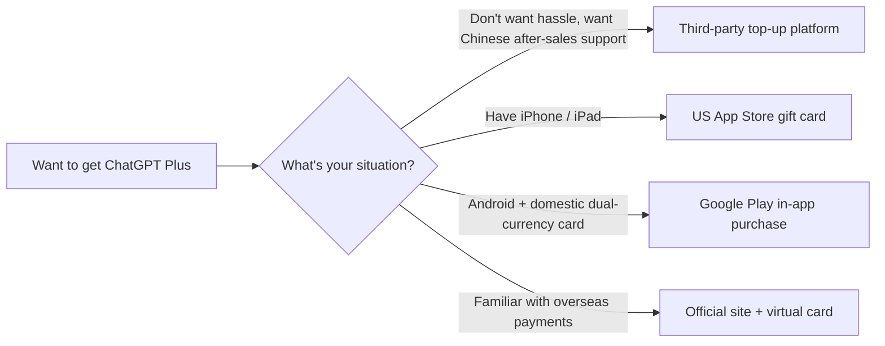

# ChatGPT Top-up Guide for Users in China: Comparing Four Methods (November 2026)

ChatGPT can be used for writing, translation, programming, and office productivity, but mainland China is not within OpenAI's officially supported regions, so direct sign-up usually gets stuck at the **account** and **payment** steps. This article compares four common ways to subscribe, for users in different situations.

## Why it's harder to get ChatGPT in China

- **Regional restriction:** Mainland China is not within the official supported regions, so registration and use may be restricted.
- **Payment restrictions:** Official site subscriptions are processed through Stripe, and domestic bank cards are often declined.
- **Three subscription systems coexist:** Official site, iOS, and Google Play…
