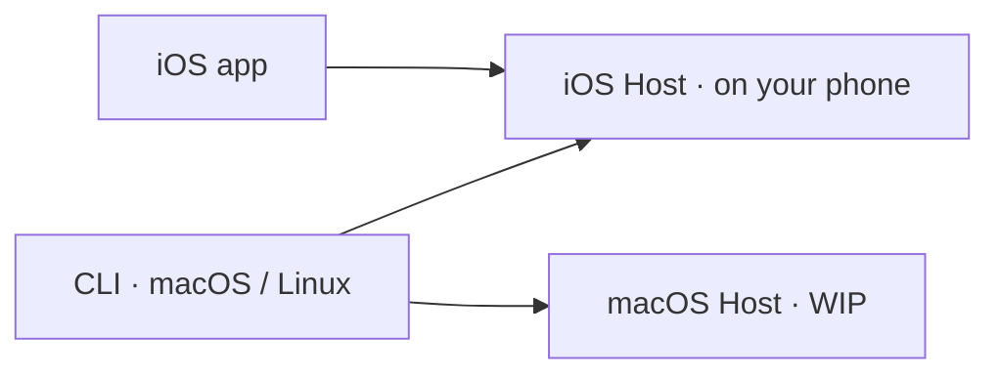

A self-evolving agent that runs on your phone.

[Website](https://openox.ai) · [App Store](https://apps.apple.com/us/app/ox-self-evolving-agent/id6802224502) · [Discord](https://discord.gg/55eS3kEEX)

---

## Features

1. **Connect anything** — Ox works across AI assistants, apps, and websites to get things done for you.
2. **Local first** — Ox runs on your device, keeping your conversations, credentials, and memory stored locally.
3. **Yours** — Open source and malleable, Ox evolves with you and uses the models you choose.

## Usage

- **Clients:** [iOS app](https://github.com/ziyzhu/openox/blob/HEAD/apps/ios) and [CLI](https://github.com/ziyzhu/openox/blob/HEAD/apps/cli) for macOS and Linux.
- **Hosts:** built-in iOS Host and standalone [macOS Host](https://github.com/ziyzhu/openox/blob/HEAD/apps/macos) (WIP).

The iOS app uses its built-in Host. The CLI can connect to either Host.

**Use Ox on iPhone**

1. Install [Ox from the App Store](https://apps.apple.com/us/app/ox-self-evolving-agent/id6802224502).
2.…
